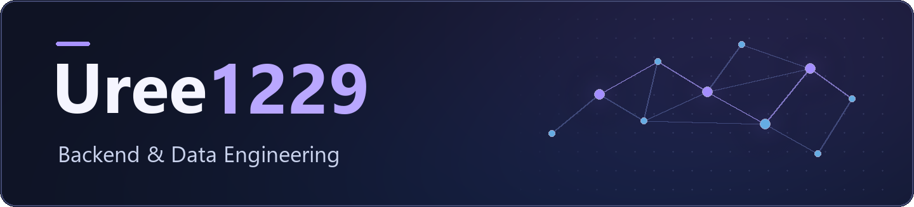

  

Python으로 데이터 조회 API를 만들고, 페이지 경계와 네트워크 장애에서 데이터 정합성을 검증합니다.

<h3 align="center">Tech Stack</h3>

  
  
  
   
  
  
  
  

<h2 align="center">SSAL.gg</h2>

관측일과 연결 관계로 뉴스 이슈를 탐색하는 운영 서비스

  
  
  

  

Live Trends에 **실제 관측일 기준 정렬·필터**를 추가했습니다. 60건을 50건과 10건으로 나눠 반환할 때 페이지 간 중복이 없는지 검증했습니다.

## 다른 프로젝트

### Blind-Match

가상 환자 기록 **200건**의 평문 코사인 유사도 Top-K 검색과 입력 검증을 구현하고, CKKS 암호화 검색 경로를 설계했습니다.  
[참고 논문](https://arxiv.org/abs/2408.06167v2)

### 응급환자 이송 지원 시스템

전송 ID로 중복 등록을 막고, DB 저장 후 응답이 유실되어도 환자 기록과 병원 문의 워크플로가 각각 **1건**만 남는지 검증했습니다.  
[저장소](https://github.com/Uree1229/emergency-care-system) · [응답 유실 테스트](https://github.com/Uree1229/emergency-care-system/blob/2eaf757/test_patient_workflow_dev1_http.py#L395-L407)

### Linux CPU Load Balancing

CPU affinity 제한 해제 후 작업이 다시 분산되기까지 걸리는 시간을 측정하고, Linux 5.4 원본 커널과 스케줄러 패치를 비교했습니다.  
[커널 패치와 벤치마크](https://github.com/Uree1229/improve-loadbalancing)
