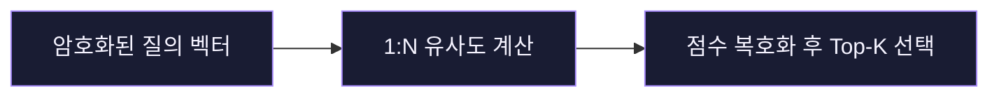

# Research Notes

동형암호를 공부하고, 데이터를 탐색하는 웹 서비스를 만듭니다.

## Blind-Match · 암호화된 의료 유사도 검색

> 환자 특징을 평문으로 드러내지 않고 유사한 과거 사례를 찾을 수 있을까?

Blind-Match 논문의 **HE-C³**가 CKKS 암호문에서 1:N 코사인 유사도를 계산하는 방식을 분석하고, 이를 의료 유사도 검색에 적용하는 흐름을 설계하고 있습니다.

[참고 논문 · Blind-Match (CIKM 2024)](https://arxiv.org/abs/2408.06167v2)

## SSAL.gg · 뉴스 트렌드 지도와 아카이브 검색

여러 매체에서 수집한 뉴스를 이슈별로 탐색할 수 있는 웹 서비스입니다. 이슈 지도에서 관련 이슈를 연결하는 로직을 개선하고, 이전에 수집한 기사도 찾을 수 있도록 아카이브 검색을 확장했습니다.

[이슈 지도 보기](https://ssalgg.whitekw.com/issue-map) · [라이브 트렌드 보기](https://ssalgg.whitekw.com/live-trends)

## 캡스톤 · 응급환자 이송 지원

환자 등록부터 병원 도착까지의 흐름을 연결하는 팀 프로젝트입니다. 등록 요청이 처리된 뒤 응답이 유실되는 상황을 다뤘습니다. 재시도해도 같은 환자 ID를 반환하고 환자 레코드가 하나만 남는지 합성 데이터로 검증했습니다.
