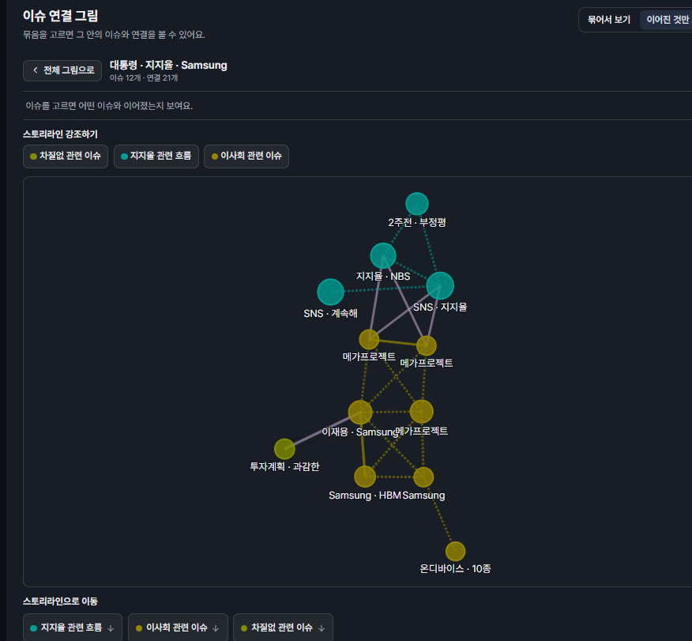

# Uree1229

Python으로 데이터 조회 API를 만들고, 페이지 경계와 네트워크 장애에서 데이터 정합성을 검증합니다.

## Selected Work

- **SSAL.gg / Live Trends** · 실제 관측일 기준으로 필터링·정렬한 뒤 50건씩 반환하고, 60건 테스트로 페이지 간 중복이 없는지 검증했습니다.
- **Blind-Match** · 가상 환자 기록 200건의 평문 코사인 유사도 Top-K 검색과 입력 검증을 구현하고, CKKS 암호화 검색 경로를 설계했습니다.
- **응급환자 이송 지원 시스템** · 전송 ID로 중복 등록을 막고, DB 저장 후 응답이 유실되어도 환자 기록과 병원 문의 워크플로가 각각 1건만 남는지 검증했습니다.
- **Linux CPU Load Balancing** · CPU affinity 제한 해제 후 작업 재분산 지연을 측정하고, 원본 커널과 스케줄러 패치를 비교했습니다.

